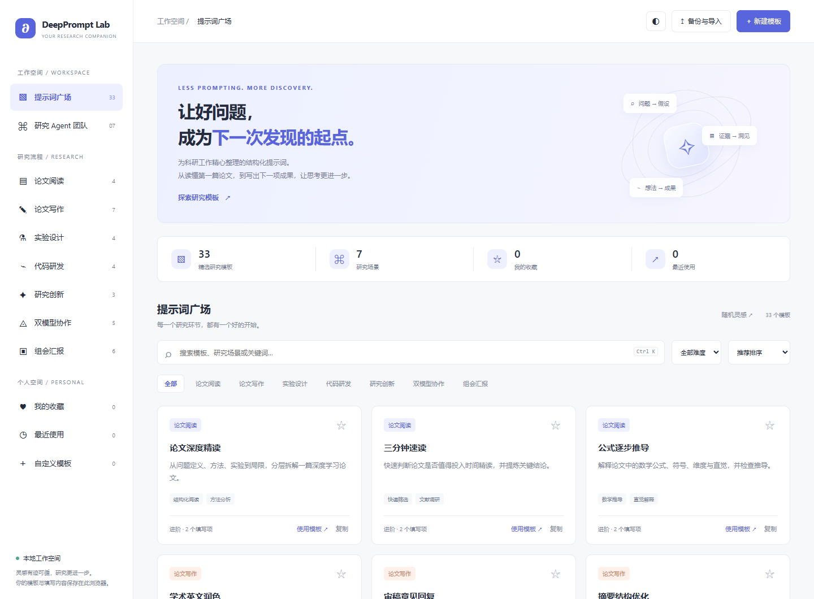
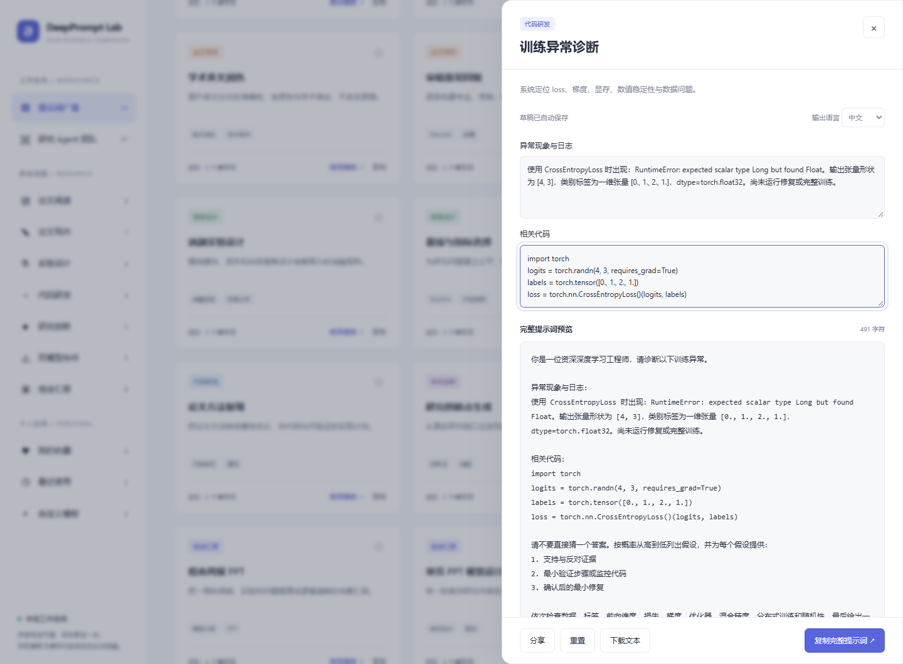

# DeepPrompt Lab

**面向中文深度学习研究者的开源提示词工作台。把论文、实验、代码和汇报任务，整理成可填写、可复用、可检查的 AI 指令。**

[](https://github.com/Asda1740765081/Deeplearning_prompt/actions/workflows/ci.yml)
[](LICENSE)

[在线体验](https://asda1740765081.github.io/Deeplearning_prompt/) · [三个操作案例](docs/EXAMPLES.md) · [参与贡献](CONTRIBUTING.md) · [路线图](ROADMAP.md) · [版本记录](CHANGELOG.md) · [English](#english-overview)



## 解决什么问题

科研任务需要交代背景、已有证据、约束和输出要求。只输入一句“帮我读论文”或“帮我调代码”，往往遗漏这些信息；每次从头组织完整指令又会重复劳动。

DeepPrompt Lab 提供 **33 个结构化模板、7 类研究场景和 7 个研究角色模板**。选择场景，填写材料，检查完整提示词，再复制到你选择的 AI 工具中。它适合研究生、整理实验任务的研究者，以及希望复用研究工作流的开发者。

这是一个早期开源项目。当前交付是可运行的静态工作台、可检查的模板和确定性测试；尚无经过独立验证的研究效率提升或广泛采用数据。

## 已实现的能力

| 能力       | 实际行为                                                               |
| ---------- | ---------------------------------------------------------------------- |
| 模板检索   | 关键词、场景、难度筛选；名称、个人评分、收藏排序；随机推荐             |
| 研究场景   | 论文阅读、论文写作、实验设计、代码研发、研究创新、双模型协作、组会汇报 |
| 变量填写   | 自动识别 `{{变量名}}`，支持中文；实时预览；保留缺失项占位符            |
| 个人空间   | 收藏、最近使用、个人评分、可创建和编辑的自定义模板                     |
| 自动保存   | 填写草稿和输出语言保存在当前浏览器，刷新后可继续填写                   |
| 导出与共享 | 文本下载；JSON 备份与合并导入；新分享链接默认不含填写材料              |
| 研究角色   | 7 个有职责和交付物约定的角色模板，以及研究团队协调模板                 |
| 使用环境   | 桌面与手机布局、深浅主题、键盘操作；无需账户、后端或 API Key           |

**角色模板需要交给外部 AI 工具执行。** 网站不会自动启动多个 Agent，不调用模型 API，不读取论文文件或运行训练代码，也不生成 PPTX。英文模式添加英文输出要求，并非在浏览器里翻译原文。



## 两分钟开始使用

1. 打开[在线演示](https://asda1740765081.github.io/Deeplearning_prompt/)，搜索“训练异常诊断”，或选择研究场景。
2. 点击“使用模板”，填写异常日志、最小代码等材料，输入会自动保存为草稿。
3. 阅读完整预览，补齐占位项，选择中文或英文输出。
4. 复制提示词到你使用的 AI 工具。核验其中的引用、代码建议和研究结论。
5. 收藏常用模板；迁移设备前，用“备份与导入”导出个人数据。

快捷键：`Ctrl/Cmd + K` 聚焦搜索；`Esc` 关闭编辑窗口。自定义模板示例：

```text
请根据以下 {{实验日志}}，围绕 {{研究问题}} 提出可验证的排查步骤。
区分观察到的事实、原因假设和需要补充的信息。不要虚构实验结果。
```

## 可复现的操作案例

案例有已提交的输入、完整生成指令和复现步骤。输入均为自编的公开演示材料，**不是用户调查、真实论文实验结果或模型效果评测**。

| 场景     | 输入 → 实际产物                                   | 查看                                                                                              |
| -------- | ------------------------------------------------- | ------------------------------------------------------------------------------------------------- |
| 论文筛选 | 最小摘要 + 调研目标 → 结构化速读提示词            | [操作](docs/EXAMPLES.md#1-论文筛选) · [完整指令](examples/outputs/paper-screening.txt)            |
| 训练诊断 | 标签类型错误日志 + 最小代码 → 诊断指令            | [操作](docs/EXAMPLES.md#2-训练异常诊断) · [完整指令](examples/outputs/training-diagnosis.txt)     |
| 组会规划 | 含失败与未完成事项的周记 → 逐页内容和时间规划指令 | [操作](docs/EXAMPLES.md#3-组会汇报规划) · [完整指令](examples/outputs/weekly-research-report.txt) |

浏览器测试将这三组输入填入真实页面，比对预览与输出文件。没有调用外部模型，也没有把生成提示词等同于研究任务完成。

## 本地使用与开发

**只使用网站：** 下载仓库后直接打开根目录 `index.html`。样式和脚本均在此文件内，主应用不依赖 CDN。部分浏览器对本地文件的存储或剪贴板有限制，可改用本地服务。

**继续开发：** 安装 Node.js 22 或更新的受支持版本：

```sh
git clone https://github.com/Asda1740765081/Deeplearning_prompt.git
cd Deeplearning_prompt
npm ci
npm run build
npm start
```

打开 `http://127.0.0.1:4173`。修改 `src/` 后执行 `npm run build`，生成可离线打开的 `index.html`。构建不需要 Python、模型服务或密钥。

```text
src/data.js              内置模板、研究分类与角色定义
src/core.js              变量替换、分享编解码、导入预校验
src/app.js               页面交互和本地存储
src/style.css            响应式布局和主题
src/index.template.html  页面结构
scripts/                构建、本地服务、案例生成
tests/                  核心测试和真实浏览器验收
examples/               演示输入和完整生成指令
docs/                   案例、截图、架构、隐私和验证说明
index.html              已提交的单文件发布产物
```

## 检查与发布

```sh
npm run check
npx playwright install chromium
npm run test:e2e
```

Linux 首次运行可用 `npx playwright install --with-deps chromium`。Windows 已安装 Edge 时，在 PowerShell 设置 `$env:PW_CHANNEL='msedge'` 后执行浏览器测试。

检查覆盖变量替换、JSON 恢复和去重、分享中的草稿保护、模板编辑、刷新恢复、移动布局与直接打开文件。详见[验证范围](docs/VALIDATION.md)。这些检查证明软件行为，不证明模型输出正确或科研质量提升。

GitHub Actions 对提交和 Pull Request 执行构建一致性、核心测试和浏览器验收。GitHub Pages 从 `main` 分支根目录发布。

## 数据与隐私

个人模板、收藏、评分与草稿保存在浏览器 `localStorage`。清除网站数据、更换浏览器或隐私模式可能丢失内容，请自行备份。不同地址（本地文件、localhost、GitHub Pages）的数据需要通过 JSON 迁移。

新分享链接只携带模板信息；自定义模板正文会进入链接，请勿把私密材料写进模板正文。旧分享链接可能包含填写值，仍支持读取。备份文件包含草稿，可能包含研究材料。

主应用没有分析脚本、追踪器或模型 API 调用。托管服务按其政策处理访问请求；README 徽章从第三方服务加载。复制到外部 AI 工具后的内容由你和该工具处理。详见[隐私与能力边界](docs/PRIVACY.md)。

## 反馈和参与

欢迎提交可复现缺陷、边界清晰的研究模板或文档改进。先阅读[贡献指南](CONTRIBUTING.md)和[路线图](ROADMAP.md)，再[创建 Issue](https://github.com/Asda1740765081/Deeplearning_prompt/issues/new/choose)。请勿上传未发表论文、受限数据或密钥。

已有 [Codex 整合说明](CODEX_INTEGRATION.md)、[DeepSeek 草案交接说明](DEEPSEEK_HANDOFF.md)和[双模型工作流](REAL_LINKUP_WORKFLOW.md)描述人工复制和审核步骤，并非已实现的自动集成。

## English overview

DeepPrompt Lab is an MIT-licensed, local-first prompt workbench for Chinese-speaking deep learning researchers. It offers 33 structured templates across seven research scenarios, seven role prompts, editable variables, personal templates, draft recovery, backup/restore, and template sharing. Open the [live demo](https://asda1740765081.github.io/Deeplearning_prompt/) or the standalone `index.html`.

It prepares instructions for an AI tool of your choice. It does not call a model, run experiments, orchestrate agents, verify citations, or generate slides. Three reproducible walkthroughs and automated checks document actual behavior; they are not evidence of model effectiveness or user adoption. See [CONTRIBUTING.md](CONTRIBUTING.md) to contribute. Licensed under [MIT](LICENSE).
